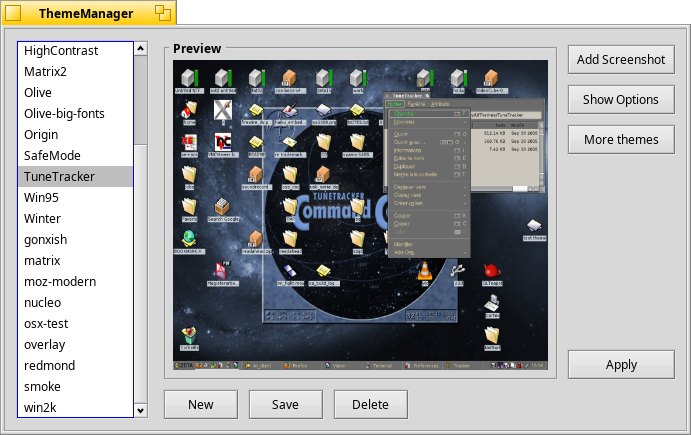

<p align="center">
  
</p>

# Haiku Theme Manager

Haiku Theme Manager is a native Haiku application for saving and applying a
coordinated desktop theme. A theme can include backgrounds, Deskbar settings,
interface colours and fonts, window decorators, sounds, Terminal colours,
screen savers and supported third-party application settings.

This project modernises Francois Revol's Theme Manager while retaining its
theme format, application signature, add-on model and BeTheme/MS Plus
importers. The untouched historical project is preserved in
[`HaikuThemeManager-Original`](HaikuThemeManager-Original).

## Build

Build on Haiku with the standard development tools installed:

```sh
make
```

The resulting `ThemeManager` executable is created by Haiku's standard
`makefile-engine`. Run it directly or install it in the Preferences menu.

## Using Theme Manager

Select a theme and choose **Apply** to activate the enabled parts of it. The
**Options** tab controls which setting groups are applied or captured. Use
**New** to capture the current desktop as a new theme, **Save** to update the
selected theme, and **Defaults** to restore Haiku's default theme values.

Theme Manager stores its preferences in
`~/config/settings/x-vnd.yT-ThemeManager` and themes in the standard Haiku
settings hierarchy. Existing settings and themes remain compatible with the
historical application.

## Heritage and licence

Theme Manager was created by Francois Revol and distributed under the MIT
License. The original application credits and localisation catalogues are
retained. The modernised shell and ongoing maintenance are by Sikosis.
